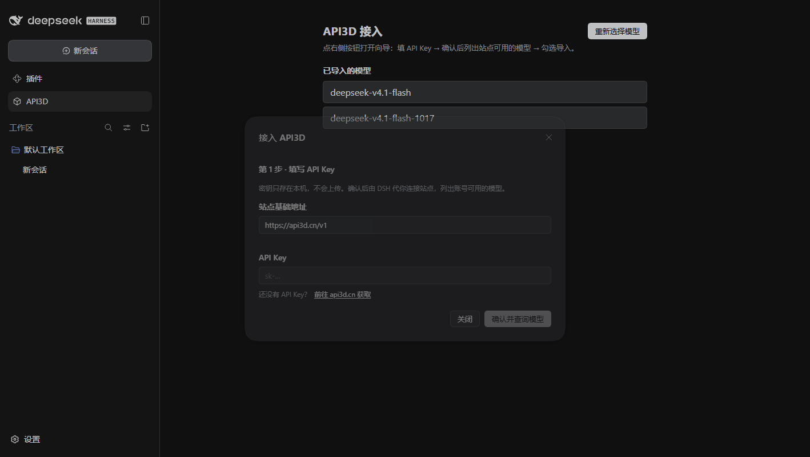
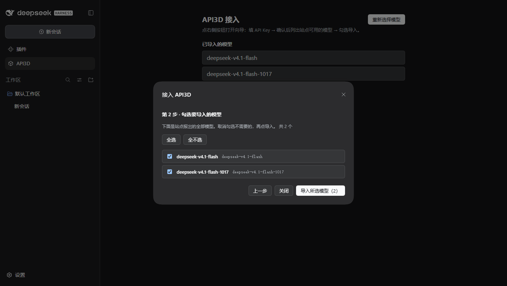
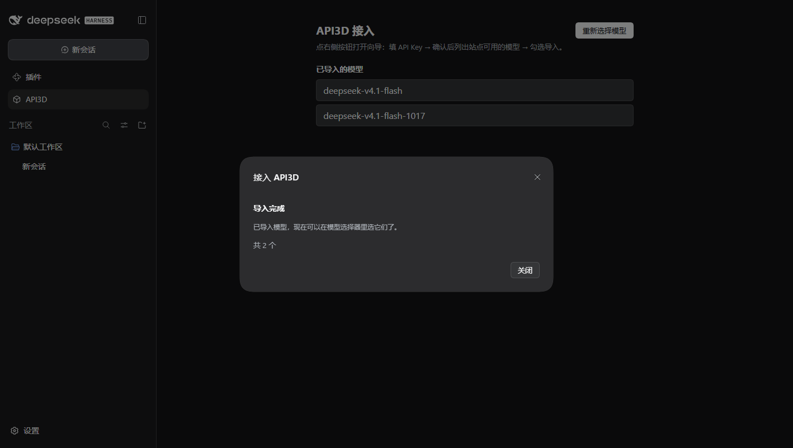
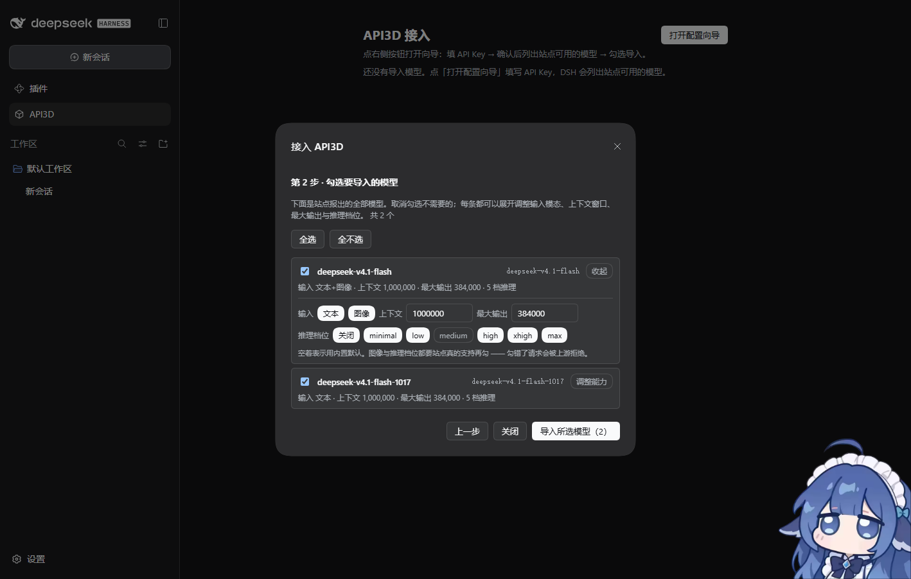

# dsh-api3d

[](https://www.npmjs.com/package/dsh-api3d)
[](https://github.com/ptb-xiaou/dsh-api3d/blob/main/LICENSE)

**中文** · [English](README.en.md)

> 📦 开源仓库：[ptb-xiaou/dsh-api3d](https://github.com/ptb-xiaou/dsh-api3d) ｜ npm：[dsh-api3d@0.2.0](https://www.npmjs.com/package/dsh-api3d) ｜ [Release v0.2.0](https://github.com/ptb-xiaou/dsh-api3d/releases/tag/v0.2.0) ｜ MIT（衍生说明见 [NOTICE](NOTICE)）

把 **API3D（[api3d.cn](https://api3d.cn)）** 这条中转站接成 DeepSeek Harness 里的
一条 pi-ai 路由，基础地址、API Key、出站兼容开关都在「插件」设置页里填，不用改文件、
不用重装。站点地址已经写在 `lib/site.js` 里，装上就是零配置可用。

这是一个**骨架**：核心链路（路由存活 + 出站围栏 + 凭据写入 + 设置卡 + 密钥/模型向导）
已经完整可跑，余额 / 用量 / 计费 / 健康探测四项留了明确的接缝，等着填。

装好后侧边栏「插件」下面会多一行 **API3D**：点进去填一次密钥、勾选站点上的模型，
就能直接用。详见「密钥与模型向导」。

## 设计取舍

一句话：**协议、模型目录、思考档位都是配置，不是代码；插件只负责「让请求真的被中转站接受」。**

- **不自研 `LlmAdapter`。** 自研一个 provider 适配器意味着复刻 harness ↔ pi-ai 的整个
  转换层（官方那个约 1000 行：Context 组装、StreamChunk 翻译、replay 状态、
  上下文溢出判定）。单站场景不值这个价。所以路由是**声明式**的：`cordis.patch.yml`
  里一条 `llm-pi-ai.providers.api3d`，复用官方适配器。
- **但声明式路由有两个坑，插件就是为它们存在的**（见下）。

### 坑一：profile 补丁层会把整条路由挤掉

profile 自己的 `llm-pi-ai.providers` 补丁在**每个 bundle 层之后**应用，而 loader 的
合并是「一层深」的：补丁里的 `config` 是**赋值**而不是深合并，所以整个 `providers`
字典会被替换。任何自带 provider 的 profile（随包发行的 `desktop` profile 就是）
都会丢掉本插件声明的路由。

宿主半读不到这件事发生在什么时候，所以就挂在解析期：`ctx.on('internal/config', …,
{ global: true })` 里把路由补回去，再通过 `ctx.get('loader')` 找到 `llm-pi-ai`
条目、`entry.update({ config })` 写回。

> 为什么不能只写一次：宿主 profile 的 watcher 会在启动后几秒重读补丁文件，
> 把一次性写入回滚。必须每次解析都补。

### 坑二：baseURL 由适配器逐请求解析，但它读不到本插件的设置

两个命名空间。所以路由的 `baseURL` 指向一台**刻意不存在**的主机
（`upstream.api3d.invalid`，RFC 2606 保留顶级域），围栏在出站时把它改写为设置里的
真实地址。

这么绕的好处是「换机房」变成设置页里的一次写入；坏处是**围栏必须在请求路径上**，
包括每一台真实端点 —— 否则 DNS 直接失败（这是刻意的大声失败，比静默打到某台真实
服务器好）。

顺带，围栏还承担了中转站常见的出站兼容：

| 出站兼容 | 为什么需要 |
| --- | --- |
| 改写 baseURL | 见上 |
| 可选替换 `User-Agent` | 有些站点按 UA 认证，而适配器会剥掉与它归属头冲突的 profile header |
| 可选直连（绕过进程代理） | 站点 WAF 常把数据中心出口 IP 判成挑战，回 200 HTML 而不是 SSE |
| 可选补 `required: []` | 站点转发到严格上游时，缺 `required` 的工具 schema 会被拒 |
| 可选静默重试 | 站点多通道转发，个别通道把本可重试的请求判成 400 |
| 402 额度错误加提示 | 站点用 402 + 被错标成 `text/event-stream` 的 JSON 报额度耗尽 |

## 目录

| 路径 | 作用 |
| --- | --- |
| `lib/site.js` | **身份常量唯一来源**：包名、行 id、provider 名、哨兵主机、默认凭据引用名。换站点先改这里 |
| `cordis.patch.yml` | 组合包补丁层：声明 `api3d` 路由 + 插入插件行。**模型目录在这里手写** |
| `lib/index.js` | 宿主半：围栏、路由存活、配额注解、设置命名空间 |
| `lib/client.js` | 浏览器半：设置卡（基础地址、API Key、兼容开关、预留的运维行）、侧边栏入口、密钥/模型向导 |
| `lib/route.js` | **生成物**，来自 `npm run gen-route`；`test/route-parity.test.mjs` 防止它与 YAML 漂移 |
| `lib/direct-fetch.js` | 直连传输（`node:http`/`node:https`，绕开进程代理） |
| `scripts/gen-route.mjs` | 从 `cordis.patch.yml` 生成 `lib/route.js`，并校验哨兵主机一致 |
| `scripts/probe-models.mjs` | 用真实 key 打一次 `GET {baseURL}/models`，核对站点在售模型与声明是否一致 |
| `test/` | 109 项断言，见下 |

## 安装与分发

装进某个 profile。[English](README.en.md)

| 方式 | 命令 | 说明 |
| --- | --- | --- |
| **npm** | `dsh plugin --profile web add dsh-api3d` | 已发布 **`dsh-api3d@0.2.0`**；查询顺序：profile 配置的 registry → `registry.npmmirror.com` |
| **GitHub 直装** | `dsh plugin --profile web add github:ptb-xiaou/dsh-api3d` | 仓库里 `lib/` 就是成品，没有构建步骤，装完即用 |
| **tarball** | `dsh plugin --profile web add https://registry.npmjs.org/dsh-api3d/-/dsh-api3d-0.2.0.tgz` | 也接受本地绝对路径的 `.tgz`；GitHub Releases 可以放同一份 tgz |
| **本地路径** | `dsh plugin --profile web add E:\path\to\dsh-api3d` | 开发用；建议装进隔离实例，别装进正在用的主实例 |

装完**重启 DSH**：插件行是 boot graph 的一部分，热载不生效。

三个实测事实（在干净隔离实例上走真实安装路径验过两遍：一次是 `npm pack` 产出的
tarball，一次是 npm 渠道的 `add dsh-api3d`；后者装的是 `dsh-api3d ^0.2.0`，
启动日志同样打出 `api3d: 路由 api3d → …`）：

1. `add` 会自动把 `dsh-api3d` 追加进该 profile `package.json` 的
   `dsh.profile.bundles`，不用手工编辑；`dependencies` 一并写入。
2. 装好的包是 `profiles/<profile>/node_modules/dsh-api3d` 下的**真实目录**，而且
   **它自己不需要 `node_modules`**：宿主半的 `import '@deepseek-ai/schemastery'`
   由 profile 内的解析层路由到应用自带的那一份。只有本地开发（插件在 profiles 目录
   之外）才需要自己软链宿主依赖，见「开发」。
3. 浏览器半同样被认出来：实例返回的 HTML 里模块清单含 `dsh-api3d`
   （`url: plugins/??dsh-api3d/client.js&rev=…`，带 `inject` 列表），启动日志打出
   `api3d: 路由 api3d → https://api3d.cn/v1，模型目录 1 个（内置）：deepseek-v4.1-flash`。

关于**版本兼容闸门**：插件管理器会检查 `peerDependencies` 里以 `@deepseek-ai/dsh`
开头的条目是否满足当前 DSH 版本，不满足就拒绝安装（除非在 profile 的
`compatibility.json` 里按精确版本开豁免）。本包只声明
`@deepseek-ai/cordis` / `@deepseek-ai/schemastery`，不在闸门范围内，所以不会卡住安装；
代价是本包**不做运行时版本自检** —— DSH 大版本升级后如果插件报错，请开 issue。

> **安全提醒**：本包的宿主半在 DSH 进程内运行，**不受工作区沙箱限制**，并且会拿到
> API Key。装之前请读 `lib/index.js`。

### 发布（维护者）

`lib/`（含手写的 `lib/client.js` 与生成的 `lib/route.js`）是**提交进版本库的成品**，
所以 `github:` 直装不需要任何构建步骤。

- **npm**：已发布 **`dsh-api3d@0.2.0`**（`latest`），公开 tarball 与本地 `npm pack`
  SHA512 完全一致。`npm pack` 核对只打包 11 个文件 —— `lib/` 5 个 + `cordis.patch.yml` +
  `README.md` + `README.en.md` + `LICENSE` + `NOTICE` + `package.json`
  （65.9 kB 打包 / 187.7 kB 解开）；`test/`、`scripts/`、`docs/` 由 `files` 白名单挡在外面。
  发版用能直接发布的 token；若账号被要求走暂存发布，`npm publish` 会报
  `E_STAGE_REQUIRED`，此时改用 `npx npm@11 stage publish` + `stage approve`（后者需要 2FA）。
  若 npm 上名字被占用，改成带 scope 的名字，并把本文档里的命令同步改掉。
- **GitHub Releases**：把 `npm pack` 的 tgz 传上去，使用者可用上面的 tarball 直装。
- 打标签前跑一遍 `npm test`（109 项）与 `npm run gen-route`（确认生成物不漂移）。

## 密钥与模型向导

装好后**不用先记字段**：侧边栏「插件」下面会多一行 **API3D**，点进去就是向导
（面板第一次打开、且还没导入模型时会自动弹出）：

1. 填站点密钥（基础地址已预填 `https://api3d.cn/v1`），点「确认并查询模型」。
   还没有密钥的话，输入框下方有一条「还没有 API Key？前往 api3d.cn 获取」，
   点它在系统浏览器里打开站点注册页（宿主按外链处理，不会在应用内嵌窗口里跑）。
2. 宿主半拿这把 key 去 `GET {baseURL}/models`，把站点实际在售的模型列出来。
3. 勾选要用的模型，点「导入所选模型」。

**第 2 步列出的不只是名字。** 每行都带一条能力摘要（形如
`输入 文本 · 上下文 1,000,000 · 最大输出 384,000 · 5 档推理`），行尾的「调整能力」可以
逐条展开修改：

| 控件 | 落到路由描述符的字段 | 初值 |
| --- | --- | --- |
| 输入：文本 / 图像 | `input` | 只勾「文本」 |
| 上下文 | `contextWindow` | 内置清单那条的值（1,000,000） |
| 最大输出 | `maxTokens` | 同上（384,000） |
| 推理档位：关闭 / minimal / low / medium / high / xhigh / max | `reasoningEfforts` | 内置清单那 6 档 |

每行的能力**互相独立**：改一行不影响其它行，也不改内置清单模板。数字留空表示「用内置默认」。

要注意的是：`api3d.cn` 的 `/v1/models` 只回 `id` 与 `display_name`，不报输入模态、上下文
窗口或推理档位，所以这里的初值是本插件的内置默认，**不是站点声明的值**。勾「图像」或加档位
之前先确认站点真的支持，否则请求会被上游拒绝。合法词汇表由 DSH 的 `dsh-llm-pi-ai` 适配器
定义：模态只有 `text` / `image`，档位只有 `off` / `minimal` / `low` / `medium` / `high` /
`xhigh` / `max`；勾成别的会在执行时被适配器拒掉。站点**真报了的**能力字段（`input` /
`input_modalities` / `context_window` / `max_input_tokens` / `limit.context` /
`max_output_tokens` / `top_provider.max_completion_tokens` 等常见写法）会被直接采用，
站点没报的才回落默认 —— 「没说」与「说了不支持」是两件事，不会互相冒充。

导入时做三件事：密钥写进 `$DSH_HOME/.credentials.yaml`、勾选的目录（连同各自的能力）写进
本插件设置 `models`、再由宿主把目录装回 `llm-pi-ai` 路由。模型选择器立刻能看到它们，不用重启。

为什么查询要绕到宿主：`api3d.cn` 的 `/v1/models` 不返回任何 `access-control-*`
头，浏览器直接请求会被跨域预检挡成 403。向导背后的两条宿主路由是：

| 路由 | 方法 | 作用 |
| --- | --- | --- |
| `/api/api3d.models` | POST `{apiKey, baseURL?}` | 宿主侧查站点模型目录，返回归一后的目录（站点真报了的输入模态/上下文/最大输出/推理档位一并带上）与一组 `defaults`（向导每行的初值） |
| `/api/api3d.apply` | POST | 把设置里已导入的目录装回 `llm-pi-ai` 路由 |

两条都注册在 `connection.fetch` 的精确路由表上，所以自动带 DSH 的 Host/Origin
围栏与浏览器会话鉴权；未授权的请求到不了处理函数。

设置卡里的字段仍然可用（等价入口）。向导只是把「填密钥 + 挑模型」这两步自动化；
出站兼容开关（UA、直连、schema 补全、静默重试、配额提示）仍在设置卡上。

这条链路已在隔离开发实例里用真实密钥跑通（填 key → 查询 → 勾选 → 导入），

| 第 1 步：填密钥 | 第 2 步：勾选模型 | 导入完成 |
| --- | --- | --- |
|  |  |  |

第 2 步展开「调整能力」后（同样是真站点、真密钥跑出来的，这行改了输入模态、上下文与最大输出）：



导入后重启开发实例，日志从 `模型目录 1 个（内置）` 变成 `模型目录 1 个（从站点导入）`，
证明目录确实落了盘并被重新读回。

## 配置

装好后在「插件」页找到本插件，设置卡上填：

| 字段 | 默认 | 说明 |
| --- | --- | --- |
| 基础地址 `baseURL` | `https://api3d.cn/v1` | 站点地址，默认已填好。**显式清空不是「用默认」，是围栏不改写、请求打到哨兵主机并 DNS 失败** |
| 凭据引用名 `apiKeyEnv` | `API3D_API_KEY` | 密钥存放位置的**键名**，不是密钥。要与 `cordis.patch.yml` 里的 `apiKeyEnv` 一致 |
| API Key | — | 单独一个按钮写入 `~/.dsh/.credentials.yaml`。单向写入，没有任何读路径会把它取回来 |
| 导入的模型目录 `models` | 空 = 用内置清单 | 向导写入的 JSON 目录，**不用手填**。留空表示用 `cordis.patch.yml` 手写的那份 |
| User-Agent | 空 | 留空保留 harness 归属头（推荐）。只有站点明确要求某个值时才填 |
| 直连策略 `directMode` | `auto` | `auto` = 只有进程真的设了代理变量才直连；`always` / `never` 用于排查 |
| 补工具 schema | 开 | 出站工具 schema 的对象节点补 `required: []` |
| 静默重试 `silentRetry` | 关 | 站点以上游瞬时错误拒绝时在插件内部重发。默认关：静默掩盖真正的 400 会把可见错误换成一个令人困惑的空回合 |
| 重试次数 `silentRetryAttempts` | 3 | 含首次，1–10 |
| 配额提示 `quotaHint` | 空 | 附加到 402 额度耗尽错误后的说明文字。留空关闭 |

`claimRoute`（默认开）与 `announce`（默认开）不是设置卡字段，在 `cordis.patch.yml`
或 profile 的 patch 里改。

### 换成别的站点要改的地方

（本站 API3D 的地址与模型都已经填好，下面只在需要换站点 / 换线路时看。）

当前声明的模型来自一次真实核对，不是猜的：

| 模型 id | 上下文 | 输出上限 | 思考档位 |
| --- | --- | --- | --- |
| `deepseek-v4.1-flash` | 1,000,000 | 384,000 | off / minimal / low / high / xhigh / max |

2026-10-20 实测：`GET https://api3d.cn/v1/models` 只返回 `deepseek-v4.1-flash`，
用同一把 key 发 `chat/completions` 也确认可用。**api3d.cn 上的
`deepseek-v4.1-flash-1017` 属于福利分组，要另一把 key**（`SUB2API_ONLINE_WELFARE_KEY`）；
用主 key 请求它会得到 `404 model_not_found`。分组不同 = 凭据不同 = 应该是另一条
provider 路由，不能并进同一条路由的模型列表。

改清单前先核对，别凭厂商名猜：

```bash
npm run probe-models                      # 用 $API3D_API_KEY 打 GET {baseURL}/models
npm run probe-models -- --ref SUB2API_API_KEY   # 或者从凭据库里取某条引用
```

脚本会做一次只读 GET，把站点自报的 id 与补丁层声明做 diff，并打印可直接粘贴的
`models:` 段。核对通过后 `npm run gen-route && npm test`。

1. **`cordis.patch.yml` 的 `models` 列表** —— 改成站点实际在售的模型 id
   （`GET {baseURL}/models`）。手工声明的 pi-ai 路由什么都不继承，容量、思考档位、
   `compat` 开关都必须重述。**不写 `models`，pi-ai 会去哨兵主机做自动发现，必然失败。**
2. **`reasoningEfforts` 的拼写** —— 键是选择器提供的档位，值是实际发出的
   `reasoning_effort`。`off:` 留空 = 提供 Off 且不发送该字段。有些站点要求显式
   `none` 且拒绝 `off`，按实测填。
3. **`lib/site.js`** —— 只有在你想改哨兵主机 / 默认凭据引用名 / provider 名时才需要。
   改完必须 `npm run gen-route`，否则 `test/route-parity.test.mjs` 会失败。

## 预留的接缝：余额 / 用量 / 计费 / 健康探测

设置卡上已经有四行占位：**余额 / 用量 / 计费 / 健康探测**，目前渲染「未接入」。

接缝的粒度是**行**而不是数字：`OPS_ROWS` 定义有哪几行，取值全部走 `opValue`。
填真数据时只动 `opValue` 一处，不动布局。

两条实现路径：

- **纯管控面（推荐先做）** —— 如果你有 `GET /api/user/balance` 这类接口，做一个纯管控
  面插件即可：`Config` + `slots.register` 卡片 + 宿主侧一个 fetch 轮询。不需要注册
  provider，也不需要碰 `globalThis.fetch`。
- **Remote 服务** —— 需要在浏览器半按需查询时，宿主半继承
  `@deepseek-ai/dsh-typert-protocol` 的 `TypertRemoteService`
  （`super(ctx, serviceKey, { namespace })` + `@Remote` 装饰方法），浏览器半
  自己 `ctx.remote.$mount(…)`。约束较硬：描述符的 codec 必须是
  `mode: 'strict'`（否则 `$mount` 直接抛），宿主方法的参数必须是朴素标识符、
  `signal` 只能放最后。本机没装 `@deepseek-ai/dsh-typert-generator`，所以描述符
  要手写 —— 这也是本骨架先不做它的原因。

## 开发

```bash
npm run gen-route     # 改过 cordis.patch.yml 后必跑
npm run probe-models  # 改模型清单前后核对站点实际提供的 id
npm test              # node --test "test/*.test.mjs"
```

依赖是**软链到宿主 `node_modules`** 的（`@deepseek-ai/schemastery` / `js-yaml` /
`react`），因为 harness 包必须是宿主的**同一份实例**（`instanceof` 安全），不能从
registry 装真拷贝。`@deepseek-ai/cordis` 与 `@deepseek-ai/schemastery` 声明为
可选 peer。

测试覆盖：

| 文件 | 覆盖 |
| --- | --- |
| `route.test.mjs` | 路由存活：补丁挤掉后是否补回、状态判定 |
| `fence.test.mjs` | 围栏：改写、白名单、非目标请求原样透传、清理时只还原本插件装的 fetch |
| `tool-schema.test.mjs` | `required: []` 补齐与 `strict: true` 跳过 |
| `silent-retry.test.mjs` | 瞬时失败判定、退避、次数上限 |
| `claim.test.mjs` | `entry.update` 写回 |
| `direct-transport.test.mjs` | 直连传输打真实 loopback 替身：header 保真、不跟随重定向、abort 切断连接 |
| `integration.test.mjs` | **端到端**：围栏 + 直连传输真的把请求送到一台 TCP 服务器；402 额度注解的边界 |
| `client-bundle.test.mjs` | 浏览器半装载契约：两半的设置命名空间必须逐字相等、六个槽位（含侧边栏入口与 `shell.overlay` 向导）、字典、向导第一步「前往 api3d.cn 获取」外链的地址与 `target`/`rel`、**表单控制器以原型方法提供时不能丢 `this`**（真机崩溃回归） |
| `models.test.mjs` | 向导的宿主半：目录归一（含站点上报的能力字段与「没说就不编造」的边界、能力字段往返）、`discoverModels` 失败分类与 `defaults`、逐模型落能力覆盖（不改模板）、`applyImportedModels` 写回、两条 `/api/api3d.*` 路由的注册与鉴权边界 |

## 已知限制

- **单站。** 只支持一个基础地址。多站请用通用网关 provider 类插件。
- **模型目录：内置清单 + 向导导入。** 默认用 `cordis.patch.yml` 手写的那份；向导导入的
  目录存在插件设置 `models` 里（落进 profile 补丁层，重启仍生效），每条可以带自己的
  `input` / `contextWindow` / `maxTokens` / `reasoningEfforts`。适配器自带的自动发现
  仍然不用 —— 它去哨兵主机发现必然失败，见「坑二」。
- **能力初值是本插件的默认，不是站点声明。** `api3d.cn` 的 `/v1/models` 不报能力，所以向导
  里看到的上下文窗口、最大输出与推理档位都来自内置清单，需要按站点实际能力逐条改；勾错了
  由上游拒绝。
- **密钥由向导代写。** 向导把这把 key 写进 `$DSH_HOME/.credentials.yaml` 的
  `API3D_API_KEY`；也可以手动在设置卡或「设置 → 模型 → API3D」里填，两条路等价。
  已配置后卡片上才出现「清除密钥」。
- **余额 / 用量 / 计费 / 健康探测未接入。** 接缝已就位，见上。
- **`directMode: never` 在站点 WAF 拦截数据中心出口时会失败**，这是预期行为。

## 出处与许可

MIT。衍生自 [aqiu817/dsh-llm-agentrouter](https://github.com/aqiu817/dsh-llm-agentrouter)
（MIT，Copyright (c) 2026 aqiu817）—— 围栏、路由自愈、静默重试、直连传输与设置卡的
骨架来自该项目，已按单站场景重构并补充了凭据写入与运维接缝。`LICENSE` 保持标准 MIT
全文（含原始版权声明），衍生与参考实现的说明单独放在 `NOTICE` 里 —— 这样 GitHub 的
许可证识别能正常标出 MIT，而归属信息也不会丢。

参考实现 [Luck9Star/dsh-gateway-provider](https://github.com/Luck9Star/dsh-gateway-provider)
（MIT，Copyright (c) 2026 Luck9Star）提供了「运行时注册 provider 路由」的路线，本骨架
走的是声明式路线，理由见开头。
